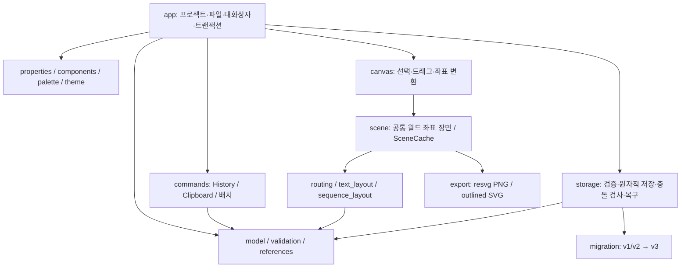

# UML Studio 아키텍처

2026-11-01 / format_version 3 / Rust + eframe 0.33.3.

## 기존 책임과 결합

`Project`는 다이어그램·도형·관계·순서가 있는 시퀀스를 소유한다. UUID 참조는 이름과 분리되어 있으며 `references`가 연결된 표시 이름을 동기화한다. `layout`, `view`, 수동 waypoint는 직렬화하지만 선택·도구·속성 초안·히스토리는 저장하지 않는다. 도메인 메서드가 `validation`, `text_layout`, 폰트가 있는 `scene`를 참조하는 논리적 결합은 남아 있다. Rust 모듈 사이의 이런 참조는 빌드 의존성 순환과 다르지만 향후 순수 geometry/font 서비스 분리 후보다.

`validation::relation`을 생성·속성 변경·정상 저장이 공유한다. 구조 오류는 로드를 거부하고, 의미 오류는 진단 후 수정할 수 있도록 손실 없이 읽는다. 복구 저장은 구조만 검사하므로 잘못된 의미 관계도 보존한다. 포함 순환과 프래그먼트의 사라진 참여자 범위도 진단한다.

`scene`은 화면·히트 테스트·PNG/SVG의 공통 장면이다. 시퀀스 이벤트는 벡터 순서로 배치하며 활성 구간과 프래그먼트는 이벤트 ID를 참조한다. 라우터는 자동·직선·직교와 명시적 연결점·수동 점을 지원한다. 자동 모드는 직선을 검사하고 간단한 직교 후보, 최대 40,000 격자점의 가시성 탐색, 점수가 가장 좋은 후보 순서로 처리한다. 장애물 없는 경로를 항상 보장하지는 않는다.

## 이번 변경

- `SceneCache`: 캔버스당 현재 다이어그램 한 개를 `Arc<Scene>`으로 보관한다. ID·종류·노드·관계·시퀀스가 바뀌면 다시 만든다. pan/zoom·선택·이름만 바뀌는 다이어그램 이름·테마는 geometry를 바꾸지 않는다. 화면 밖 primitive는 painter 제출 전에 생략하고 히트 테스트·내보내기에는 전체 장면을 유지한다.
- `SceneCache::reflow_changed`와 앱의 프레임 전후 비교로 바뀌지 않은 노드의 폰트 측정을 반복하지 않는다. 모델에 UI 캐시나 새 저장 필드를 추가하지 않았다.
- `FileRevision`: 로드한 실제 바이트를 기억한다. 저장 직전 `.uml-lock`을 `create_new`로 확보하고 원본 바이트와 비교한다. 협력하는 앱 인스턴스끼리 check/rename 경쟁을 막고, 변경·삭제된 원본은 덮어쓰지 않는다. 다른 이름 저장은 대상 경로가 현재 파일과 같으면 같은 검사를 적용한다.
- `atomic_write`: 같은 디렉터리에 배타적 임시 파일 생성 → 권한 유지 → write → 파일 sync → close → rename → Unix 디렉터리 sync. 실패 시 임시 파일 제거. rename 이후 디렉터리 sync 실패는 파일이 교체됐을 수도 있는 오류다.
- `RecoveryStore`: 편집 세션마다 UUID 파일을 소유한다. 정상 저장·변경 버리기는 자기 사본만 지운다. 시작 화면은 기존 단일 복구 파일과 다른 세션 사본을 나열한다. 복구는 자기 사본을 먼저 확보하고 원본 스냅샷을 유지한다. 살아 있는 다른 인스턴스의 사본도 목록에 나올 수 있다.
- 포함 이동·정렬·균등 배치는 조상 관계를 따라 모든 하위 요소에 적용하며 다중 선택 시 한 번만 이동한다. 방문 집합으로 손상된 순환도 무한 반복하지 않는다.
- `Preferences.dark_mode`에 기본값을 두어 이전 설정 파일과 호환한다. 화면 테마는 모델/출력에 영향을 주지 않는다.

## 이력과 남은 비용

History는 명령 객체의 역연산이 아닌 프로젝트 스냅샷 100개다. 앱이 입력 묶음을 트랜잭션으로 기록하며 Undo/Redo는 현재 뷰를 유지한다. 신뢰성과 기존 파일 호환성을 위해 이번에 전면 교체하지 않았다. `app::update`의 프로젝트 clone, `Catalog`, 진단, 라우팅의 선형 검색은 남아 있다. 1,000개 노드 드래그가 약 20ms인 이유를 추가 프로파일링한 뒤 증분 명령·인덱싱을 도입하는 것이 다음 단계다.

최근 목록·테마 설정은 여러 인스턴스에서 마지막 저장이 우선한다. 프로젝트/복구 데이터와 별개이며 설정 병합은 제공하지 않는다.

저장 잠금은 앱끼리 협력하는 경로 기반 잠금이다. 잠금을 무시하는 외부 프로그램, 심볼릭 링크 등 다른 경로 별칭, 네트워크 파일시스템의 원자성까지 보장하지 않는다. 강제 종료 시 잠금 파일이 남으면 모든 편집기를 종료하고 원본/복구를 백업한 뒤 해당 잠금만 제거해야 한다. 자동으로 살아 있는 잠금을 탈취하지 않는다.
